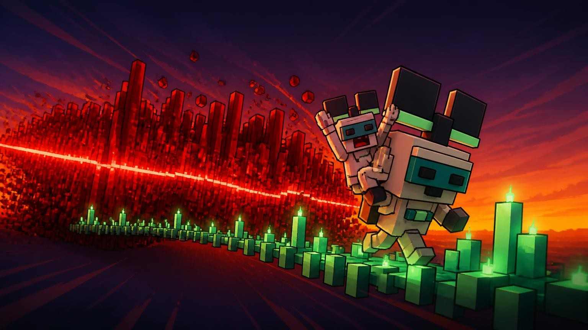
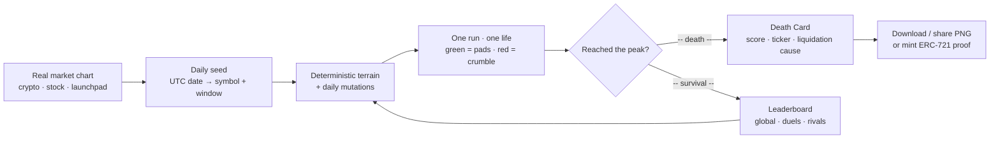
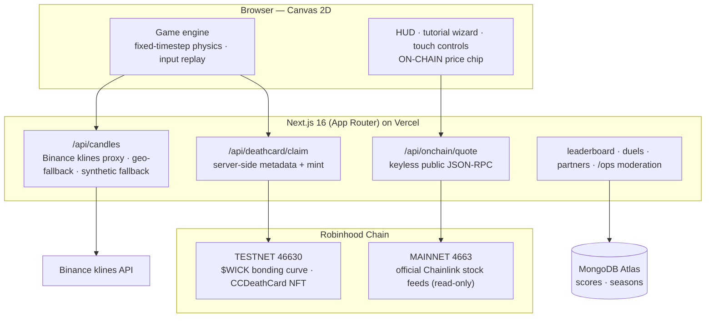
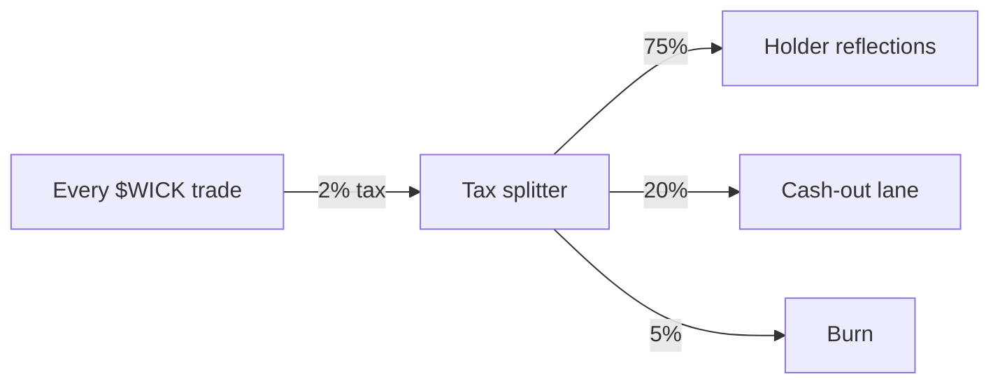
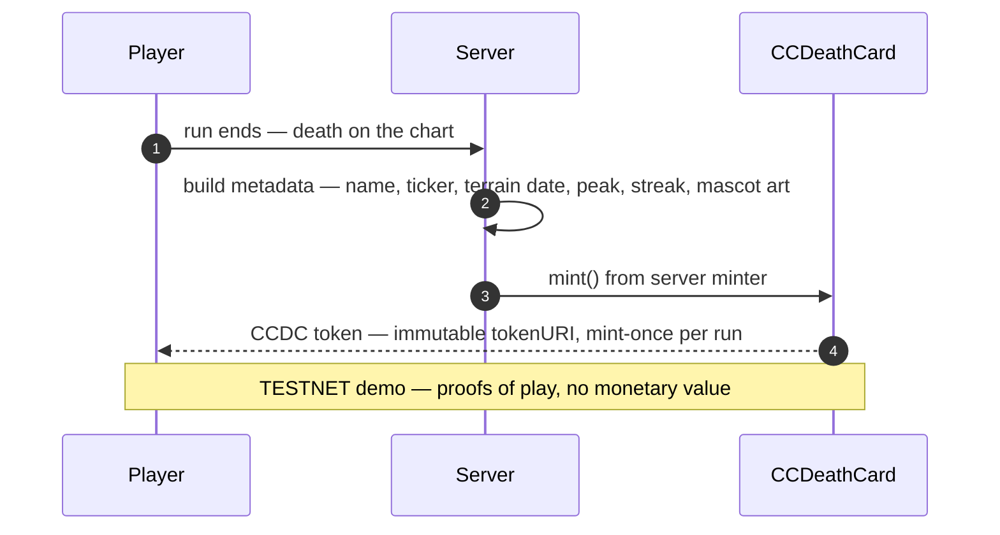

<div align="center">



# 🕯️ Candle Climber — $WICK

**The chart is the level.** A browser precision-platformer whose terrain *is* the real market chart.

[▶ PLAY](https://candle-climber.vercel.app/play) · [$WICK token (testnet)](https://testnet.vibevibe.fun/token/0xe2ce0be4e3d420c1e4b5c46493b3d5e03595216c) · [Architecture](#-architecture) · [Documentation](#-documentation)


</div>

> ⚠️ **Honesty first — this is a TESTNET project.** $WICK launched on the VibeVibe
> testnet bonding curve (Robinhood Chain testnet) on **2026-10-05**. No real money
> is involved anywhere; the Death Card NFTs are on-chain proofs of play with
> **zero monetary value**. We say this everywhere on purpose. Not affiliated with
> Robinhood Marketplaces, Inc. — built on the public Robinhood Chain testnet.

You are a small blocky trader running up a live chart. Green candles are solid
jump pads. Red candles crumble under your feet. Fall off the bottom of the
screen and you are — obviously — **liquidated**. One life per run, exactly like
the market: no rewinds.

- **Free to play, no wallet needed.** A wallet connects only for the official
  competitive lane (leaderboards / seasons).
- **Every UTC day = one fresh deterministic terrain** built from one real
  symbol's chart — identical for every player worldwide, plus 6-pool daily
  mutations.
- **3 modes:** CRYPTO · STOCKS · LAUNCHPAD (launch-of-the-day curves).
- **Death Cards (ERC-721):** die on the chart and the run can be minted as an
  on-chain proof — ticker, terrain date, peak height, streak. Mint-once
  enforced by the contract.
- **Shareable everything:** 1080×1350 Death Card PNG download / WebShare,
  PvP duels on the same chart, rival AI bot, global leaderboard.

## 🎮 The loop



Terrain physics is a fixed-timestep Canvas 2D engine with coyote time, jump
buffering and crumble timers — the game part is a real platformer, not a
clicker. Levels derived from official spot feeds are labeled `derived`; when
official data is unavailable the value stays `null` and nothing is synthesised
to look official.

## 🏗️ Architecture



| Layer | Choice |
|---|---|
| App | Next.js 16 (App Router, React 19, TypeScript strict) on Vercel |
| Game | Canvas 2D, fixed-timestep physics, deterministic daily seeds |
| Runtime | Bun (dev · test · scripts), 608 tests across 52 files |
| Data | Binance klines (server proxy + fallbacks) · Chainlink AggregatorV3 reads |
| Chain | viem-style raw `eth_call` JSON-RPC — keyless, no third-party key service |
| DB | MongoDB Atlas (leaderboard, seasons, duels) |
| Quality | GitHub Actions (CI, E2E, LambdaTest real-device grid), ESLint, `tsc --noEmit` |

## 💰 $WICK — the token loop (testnet)

`0xe2ce0be4e3d420c1e4b5c46493b3d5e03595216c` · launched 2026-10-05 · curve launch #5963



Scores are **never** tied to holdings — the ladder is pure skill
(anti-sybil by design: no reward loop is tied to self-play or balance size).
Pre-graduation the token is transfer-locked; all economy lanes ship behind
explicit on-chain gates.

## 🃏 Death Cards — on-chain proof of play

`CCDeathCard` · `0x3e2735c670ac6d6412a79153602d7e9c58640c64` · ERC-721 on testnet 46630



The card art is the project's own mascot work (same art system as the landing
banner — see [ART-DIRECTION](docs/ART-DIRECTION.md)). The metadata builder is
pinned by tests so the on-chain image URL can never silently 404. Honest
caveat: cards minted before the image upgrade stay image-less forever —
`tokenURIData` is immutable by design
([full note](docs/DEATHCARD-NFT-TESTNET-NOTE.md)).

## ✅ Engineering quality

- **608 automated tests, all green** — unit + integration + economics +
  contract-model suites (`bun test`).
- **8-profile real-browser matrix against production** — iPhone SE/13/15 Pro
  Max, iPad mini/Air/Pro 12.9, Pixel 7, desktop Chrome: **97/97 checks PASS**,
  artifacts committed under `qa/realdevice/`.
- **LambdaTest real-device grid** — win11-chrome, win11-firefox + a **physical
  Pixel 7**: session validates the full player path on every push to `main`
  ([workflow](.github/workflows/realdevice.yml)).
- **Security posture** — strict CSP with per-request nonces, Lighthouse
  a11y/SEO/best-practices 100 across landing/play/stats/partners, honest 503s,
  ops moderation gate.

## 📡 Data honesty — official feeds, never invented

- **Official stock price.** Every stock level is checked against the official
  Chainlink price feed on **Robinhood Chain mainnet (chain 4663)**, read keyless
  over the public JSON-RPC. The HUD shows an `ON-CHAIN <SYM> $…` chip when the
  level's final close agrees with it, and
  `GET /api/onchain/quote?symbol=TSLA` exposes the same read with no game
  involved. Re-verify any time with `bun scripts/verify-feeds.ts`.
- **Mainnet ≠ testnet.** The testnet faucet Stock Tokens (chain 46630) are a
  *different contract set* with **mock** feeds — read for identity only, never
  priced. Raw `eth_call` evidence:
  [ROBINHOOD-CHAIN-INTEGRATION](docs/ROBINHOOD-CHAIN-INTEGRATION.md).
- **No on-chain OHLC exists.** The official feed is a *spot* price, so derived
  terrain is labeled `derived` / "official on-chain price" — never "live data".
  When official data is unavailable the value stays `null`; nothing is
  synthesised to look official.
- Every public claim is tracked against code and evidence in
  [TRUTH-TABLE](docs/TRUTH-TABLE.md); every feed is registered in
  [FEEDS](docs/FEEDS.md).

## 🚀 Quickstart

```bash
bun install            # bun >= 1.x
bun run dev            # Next.js dev server on :3000
bun test               # 608 tests
bun run lint           # ESLint
bunx tsc --noEmit      # type check
bun scripts/verify-feeds.ts   # re-verify on-chain stock feeds
```

Play locally at `http://localhost:3000/play`. Every external integration
(feeds, chain, DB) degrades gracefully — the game boots with zero credentials.

## 📚 Documentation

| Doc | What's inside |
|---|---|
| [GAME_DESIGN](docs/GAME_DESIGN.md) | mechanics, scoring, modes, retired-layers ledger |
| [INFRASTRUCTURE](docs/INFRASTRUCTURE.md) | deployment topology, env vars, ops gates |
| [FEEDS](docs/FEEDS.md) · [TRUTH-TABLE](docs/TRUTH-TABLE.md) | registered feeds · claim-by-claim honesty audit |
| [ROBINHOOD-CHAIN-INTEGRATION](docs/ROBINHOOD-CHAIN-INTEGRATION.md) | raw `eth_call` evidence for every chain read |
| [DEATHCARD-NFT-TESTNET-NOTE](docs/DEATHCARD-NFT-TESTNET-NOTE.md) | NFT contract, metadata, immutability caveats |
| [ART-DIRECTION](docs/ART-DIRECTION.md) · [ART_PROMPTS_V2](docs/ART_PROMPTS_V2.md) | visual system and asset pipeline |
| [PLATFORMER-UX-RESEARCH](docs/PLATFORMER-UX-RESEARCH.md) | input/UX research behind the engine feel |
| [RETIRED-FEATURES](docs/RETIRED-FEATURES.md) | decisions ledger — retired layers and why they stay retired |
| [PR-CHECKLIST](docs/PR-CHECKLIST.md) | review gates |

<div align="center">

**▶ [Play the current day's chart](https://candle-climber.vercel.app/play)** — one terrain per UTC day, same for everyone.

$WICK and CCDC are testnet artifacts. Nothing here is financial advice, an
investment, or a promise of value — it is a game with an honest on-chain
demo economy.

</div>
